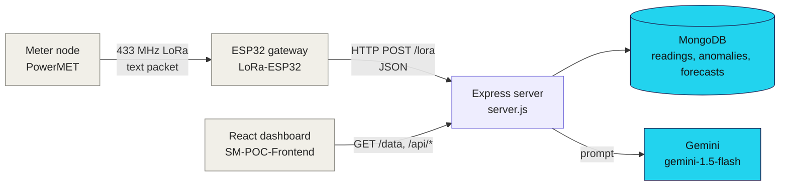

<div align="center">


<a href="#-api"></a>

<br/>

[](server.js)
[](https://expressjs.com)
[](models)
[](services/geminiService.js)
[](https://render.com)
<br/>
[](#-status-and-known-limitations)
[](LICENSE)

</div>

---

##  Project Overview

The backend of a smart-meter proof of concept (September 2025). A LoRa gateway posts each meter reading to this server, which stores it in MongoDB. The dashboard in [SM-POC-Frontend](https://github.com/mukesh-dev-git/SM-POC-Frontend) reads the data back, plus two analytics feeds (anomalies and a power forecast) and a short energy summary written by Google Gemini.

### Key Features

-  **Reading ingest**: `POST /lora` stores `deviceId`, voltage, current, power, energy, RSSI and the device tick, and stamps the server receive time.
-  **Live data**: `GET /data` returns the 50 newest readings.
-  **Anomalies**: the latest 50 stored anomalies plus the last 24 hours of readings for context.
-  **Forecast**: the most recent stored power forecast plus the last 6 hours of readings.
-  **AI summary**: `GET /api/summary` sends the 10 latest anomalies and the forecast to Gemini and returns its text (overall status, key observations, one recommendation).

##  How It Works



The `anomalies` and `forecasts` collections are only **read** here. Nothing in this repository creates those documents, so they were meant to be filled by a separate analytics job that is not part of the repo.

##  API

| Method | Endpoint | What it does |
|---|---|---|
| POST | `/lora` | Body `{ deviceId, timestamp, voltage, current, power, energy, rssi }`, all required. Saves one reading; `201` on success, `500` if a field is missing or the save fails |
| GET | `/data` | The 50 newest readings, newest first (sorted by `receivedAt`) |
| GET | `/api/anomalies` | `{ anomalies, contextReadings }`: latest 50 anomalies and the readings from the last 24 hours, oldest first |
| GET | `/api/forecast` | `{ forecast, recentReadings }`: newest forecast (`null` if none) and the readings from the last 6 hours |
| GET | `/api/summary` | `{ summary }`: Gemini text, or `"Not enough data to generate a summary."` when there is no forecast |

There is no authentication on any route, and CORS allows every origin.

##  Data Model

| Collection | Fields |
|---|---|
| `readings` | `deviceId`, `timestamp` (device tick in ms, from the STM32), `voltage`, `current`, `power`, `energy`, `rssi`, `receivedAt` (server time, indexed) |
| `anomalies` | `timestamp`, `power`, `voltage`, `type`, `detectedAt` (indexed on `timestamp`) |
| `forecasts` | `createdAt`, `startTime`, `forecast.timestamps[]`, `forecast.power_watts[]` (indexed on `createdAt`) |

##  Quick Start

You need Node.js and a MongoDB database (Atlas free tier or a local `mongod`). A Gemini API key is only needed for `/api/summary`.

```bash
git clone https://github.com/mukesh-dev-git/SM-POC-Backend.git
cd SM-POC-Backend
npm install
cp .env.example .env      # set MONGO_URI and GEMINI_API_KEY
node server.js            # http://localhost:3001, or PORT
```

`package.json` has no `start` script, so run `node server.js` directly. The server exits at start-up if the MongoDB connection fails.

Send a test reading and read it back:

```bash
curl -X POST http://localhost:3001/lora \
  -H "Content-Type: application/json" \
  -d '{"deviceId":"PM001","timestamp":120000,"voltage":230.4,"current":1.25,"power":288,"energy":12.5,"rssi":-72}'

curl http://localhost:3001/data
```

##  Project Structure

```
SM-POC-Backend/
├── server.js                  # Express app, Mongo connection, all routes
├── models/
│   ├── reading.js             # Reading schema
│   ├── anomaly.js             # Anomaly schema
│   └── forecast.js            # Forecast schema
├── services/
│   └── geminiService.js       # builds the prompt and calls Gemini
├── .env.example
└── package.json
```

##  Status and Known Limitations

A proof of concept that was deployed on Render and is now offline.

| Area | State |
|---|---|
| Reading ingest and `/data` | Working |
| `/api/anomalies`, `/api/forecast` | Work, but return empty results unless something writes to the `anomalies` and `forecasts` collections; no such code is in this repo |
| `/api/summary` | Needs a forecast document. Uses `gemini-1.5-flash`, a model Google has since retired, so set a current model name in `services/geminiService.js`. Failures return a plain error string with HTTP 200 |
| Summary prompt | Says "last 24 hours" but passes the 10 newest anomalies regardless of age |
| Validation | A missing field gives `500`, not `400` |
| Security | No authentication, no rate limiting, open CORS: anyone can post readings |
| Run script, tests | No `start` script (and `main` points to a missing `index.js`); no tests |

### External services

| Service | Used for | State |
|---|---|---|
| Render (`sm-poc-backend.onrender.com`) | Hosting | Gone: the URL returns 404 with `x-render-routing: no-server` |
| MongoDB Atlas | Database | The connection string was never committed (it is read from `MONGO_URI`), so the cluster could not be checked; bring your own |
| Google Gemini API | `/api/summary` | Needs your own `GEMINI_API_KEY`; the model name in the code is retired |

##  Related Repositories

- [SM-POC-Frontend](https://github.com/mukesh-dev-git/SM-POC-Frontend): the React dashboard that calls this API.
- [LoRa-ESP32](https://github.com/mukesh-dev-git/LoRa-ESP32): the ESP32 gateway that receives LoRa packets and posts them to `/lora`.
- [PowerMET](https://github.com/mukesh-dev-git/PowerMET): the STM32 meter node that sends the packets.
- [SM-Dev1](https://github.com/mukesh-dev-git/SM-Dev1): a later STM32L432 + Wio-E5 LoRaWAN bring-up for the same smart-meter idea. It does not talk to this API.

##  License

MIT. See [LICENSE](LICENSE).

<div align="center">


</div>
